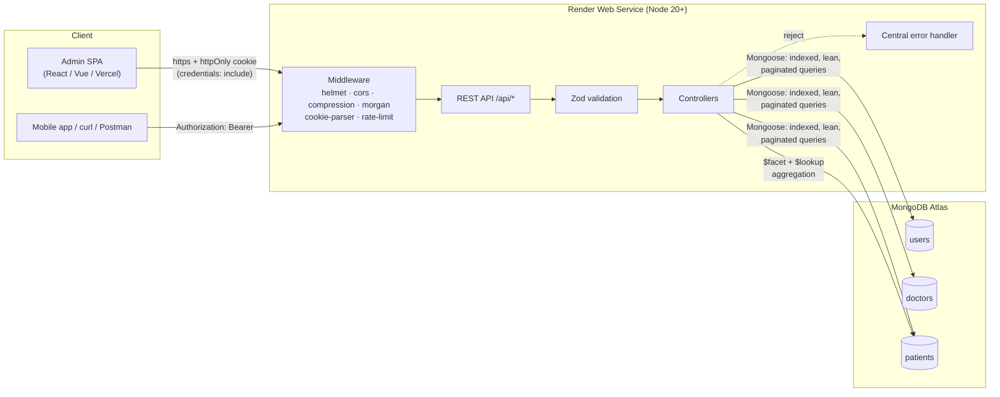

# 🩺 Doctor Tracker — Backend API

Secure REST API for managing doctors and their patients.
**Node.js · Express · MongoDB (Mongoose) · JWT in httpOnly cookies · Zod · bcrypt**

---

## Elevator Pitch

Doctor Tracker is a secure admin API that replaces the spreadsheet a clinic uses to track its doctors and patients: it lets an administrator search and filter doctors by specialisation or hospital, browse the patients assigned to each doctor, add or update patient records, and open a single dashboard that answers the questions a clinic manager actually asks — how many doctors and patients do we have, who is seeing the most patients, which conditions are most common, and are we growing this month compared with last? Every endpoint is authenticated with a short-lived JWT stored in an httpOnly cookie, every input is validated with Zod, and every list query is paginated and index-backed so the API stays fast as the data grows.

**Live API:** `https://doctor-tracker-api.onrender.com` *(placeholder — replace after deploying)*
**Live Frontend:** `https://doctor-tracker.vercel.app` *(placeholder — replace after deploying)*
**Health check:** `https://doctor-tracker-api.onrender.com/health`

---

## Demo Credentials

| Email | Password |
| --- | --- |
| `admin@doctortracker.com` | `Admin@12345` |

> Created by `npm run seed`. These are demo credentials for a seeded database —
> change or delete the account before putting real data in the system.

---

## Table of Contents

1. [Features](#features)
2. [Tech Stack](#tech-stack)
3. [System Architecture](#system-architecture)
4. [Project Structure](#project-structure)
5. [Setup Guide](#setup-guide)
6. [Environment Variables](#environment-variables)
7. [API Reference](#api-reference)
8. [Technical Decisions](#technical-decisions)
9. [Response Contract](#response-contract)
10. [Testing with curl](#testing-with-curl)
11. [Deployment on Render](#deployment-on-render)
12. [Scripts](#scripts)

---

## Features

| Area | What you get |
| --- | --- |
| **Auth** | Login / logout / me, JWT in an httpOnly cookie **and** `Authorization: Bearer`, bcrypt (cost 12), per-IP **and** per-account rate limiting on login |
| **Doctors** | List with search / specialisation / hospital / date filters, pagination, whitelisted sorting, create, detail (with patient count), update, safe delete |
| **Patients** | Global list with search / condition / doctor / date filters, CRUD, nested routes under a doctor |
| **Dashboard** | Total doctors & patients, top-10 doctors by patient count, patients per condition, patients per day (30 d), doctors per month (12 mo) — all in **one** response |
| **Validation** | Every body / query / param parsed with Zod; clean `400` with field-level errors |
| **Hardening** | helmet, CORS allow-list with credentials, compression, morgan, escaped regexes, no stack traces ever leaked |
| **Ops** | `/health` probe that never touches the DB, graceful shutdown, clear startup errors, Render blueprint, seed script |
| **DX** | ES Modules, layered structure, `.env.example`, npm scripts, fully documented indexes |

---

## Tech Stack

| Layer | Choice |
| --- | --- |
| Runtime | Node.js **20+ (LTS)**, ES Modules |
| Framework | Express 4 |
| Database | MongoDB (Atlas compatible) via Mongoose 8 |
| Auth | `jsonwebtoken` + `bcryptjs` |
| Validation | Zod 3 |
| Security | helmet, cors, express-rate-limit |
| Observability | morgan |
| Seeding | `@faker-js/faker` |

> `bcryptjs` implements the bcrypt algorithm with the same `$2a$12$` hash format as the
> native `bcrypt` package, but needs no C++ toolchain — deploys on Render/Docker are
> deterministic and cannot fail on a compiler.

---

## System Architecture

### High level



### Authentication flow

```mermaid
sequenceDiagram
    autonumber
    participant U as Admin (browser)
    participant F as SPA (Vercel)
    participant A as API (Render)
    participant D as MongoDB

    U->>F: email + password
    F->>A: POST /api/auth/login (credentials: include)
    A->>D: findOne({ email }).select('+password')
    D-->>A: user + bcrypt hash
    A->>A: bcrypt.compare(password, hash)
    alt valid
        A->>A: sign JWT { sub, email, role } (7d)
        A-->>F: 200 + Set-Cookie: dt_token=…;<br/>HttpOnly; Secure; SameSite=None
        F-->>U: redirect to dashboard
    else invalid
        A-->>F: 401 { success:false, message:"Invalid email or password." }
    end

    Note over F,A: Every later request
    F->>A: GET /api/doctors (cookie sent automatically by the browser)
    A->>A: verify JWT signature + expiry
    A->>D: findById(sub) → user still exists / role current
    A-->>F: 200 { success:true, data:[…], pagination:{…} }

    Note over F,A: Non-browser clients
    A-->>F: response body also contains `token`
    F->>A: Authorization: Bearer <token>
```

### Request lifecycle

```
Client → helmet/cors/rate-limit → router → protect (JWT) → Zod validate
       → controller → Mongoose/MongoDB → { success, data, pagination }
                                   ↘ error → { success:false, message, errors }
```

---

## Project Structure

```
doctor-tracker-backend/
├── src/
│   ├── config/
│   │   ├── env.js                  # validated env, cookie policy, fail-fast checks
│   │   └── db.js                   # Mongoose connection + actionable error hints
│   ├── models/
│   │   ├── User.js                 # admin account, bcrypt pre-save hook
│   │   ├── Doctor.js               # indexed doctor schema
│   │   └── Patient.js              # indexed patient schema (ref: Doctor)
│   ├── controllers/
│   │   ├── auth.controller.js
│   │   ├── doctor.controller.js
│   │   ├── patient.controller.js
│   │   └── dashboard.controller.js # $facet aggregations
│   ├── routes/
│   │   ├── auth.routes.js          # + login rate limiters
│   │   ├── doctor.routes.js
│   │   ├── patient.routes.js
│   │   ├── dashboard.routes.js
│   │   └── index.js                # mounts everything under /api
│   ├── middleware/
│   │   ├── auth.js                 # protect / authorize / signToken
│   │   ├── validate.js             # Zod middleware (body, query, params)
│   │   ├── errorHandler.js
│   │   └── notFound.js
│   ├── validators/
│   │   ├── common.schema.js
│   │   ├── auth.schema.js
│   │   ├── doctor.schema.js
│   │   └── patient.schema.js
│   ├── utils/
│   │   ├── ApiError.js
│   │   ├── asyncHandler.js
│   │   ├── pagination.js
│   │   ├── response.js
│   │   ├── search.js               # regex escaping (anti-ReDoS)
│   │   └── transaction.js
│   ├── seed/seed.js                # 1 admin · 20 doctors · 150 patients
│   ├── app.js                      # Express app factory
│   └── server.js                   # bootstrap, 0.0.0.0 bind, graceful shutdown
├── .env.example
├── .gitignore
├── nodemon.json
├── render.yaml                     # Render blueprint
├── package.json
└── README.md
```

---

## Setup Guide

### Prerequisites

- **Node.js 20+** (an active LTS release) and npm
- A MongoDB instance — local `mongod` **or** a free **MongoDB Atlas** cluster

### 1. Install dependencies

```bash
git clone <your-repo-url> doctor-tracker-backend
cd doctor-tracker-backend
npm install
```

### 2. Create the environment file

```bash
cp .env.example .env          # Windows: Copy-Item .env.example .env
```

Open `.env` and set at minimum:

```env
NODE_ENV=development
MONGO_URI=mongodb://127.0.0.1:27017/doctor-tracker
JWT_SECRET=<at least 32 random characters>
CLIENT_URL=http://localhost:5173
```

Generate a strong secret:

```bash
node -e "console.log(require('crypto').randomBytes(48).toString('base64url'))"
```

The server **will refuse to start** without `MONGO_URI` and prints a clear message
telling you where to set it.

### 3. Seed demo data

```bash
npm run seed
```

Creates **1 admin + 20 doctors + 150 patients** and ensures all indexes exist.

```
email:    admin@doctortracker.com
password: Admin@12345
```

### 4. Run the server

```bash
npm run dev     # nodemon, auto-restart on file changes
# or
npm start       # plain node (what Render runs)
```

| URL | Purpose |
| --- | --- |
| `http://localhost:5000/api` | API base path |
| `http://localhost:5000/health` | Health probe |

### 5. Verify

```bash
curl http://localhost:5000/health
```

```json
{
  "success": true,
  "status": "ok",
  "service": "doctor-tracker-api",
  "environment": "development",
  "uptime": 12,
  "database": "connected"
}
```

### 6. Connect a frontend

```js
// fetch
fetch('http://localhost:5000/api/doctors', { credentials: 'include' });

// axios
axios.defaults.withCredentials = true;
```

---

## Environment Variables

| Variable | Required | Default | Description |
| --- | :---: | --- | --- |
| `NODE_ENV` | **yes** | `development` | `development` \| `production` \| `test`. Drives cookie flags, logging and error verbosity. |
| `PORT` | no | `5000` | HTTP port. Render injects this automatically. |
| `MONGO_URI` | **yes** | — | Mongo connection string. Server exits with a clear message if missing. |
| `JWT_SECRET` | **yes in prod** | dev-only value | Token signing secret, minimum 32 chars in production. |
| `JWT_EXPIRES_IN` | no | `7d` | Token lifetime (`ms` format). |
| `CLIENT_URL` | **yes in prod** | `http://localhost:5173` | Comma-separated CORS allow-list of exact origins. |
| `LOG_FORMAT` | no | `dev` / `combined` | morgan format. |
| `RATE_LIMIT_ENABLED` | no | `true` | Master switch for the global limiter. |
| `COOKIE_NAME` | no | `dt_token` | Session cookie name. |
| `COOKIE_DOMAIN` | no | — | Set to `.example.com` to share the cookie across subdomains. |

**Cookie policy (derived from `NODE_ENV`)**

| | `httpOnly` | `secure` | `sameSite` |
| --- | :---: | :---: | :---: |
| `development` | ✅ | ❌ | `lax` |
| `production` | ✅ | ✅ | `none` |

`SameSite=None` requires `Secure`, so production only works over HTTPS — Render and
Vercel both provide it by default.

---

## API Reference

Base URL: `/api`. **Auth required = ✅** means a valid session cookie *or* a Bearer token.

| Method | Path | Description | Auth |
| --- | --- | --- | :---: |
| `GET` | `/health` | Fast health probe — no DB access | ❌ |
| `POST` | `/api/auth/login` | Sign in, sets `dt_token` cookie + returns token | ❌ |
| `POST` | `/api/auth/logout` | Clear the session cookie (idempotent) | ❌ |
| `GET` | `/api/auth/me` | Current user profile | ✅ |
| `POST` | `/api/auth/register` | Create an additional admin | ✅ |
| `GET` | `/api/doctors` | Paginated, filterable doctor list | ✅ |
| `POST` | `/api/doctors` | Create a doctor | ✅ |
| `GET` | `/api/doctors/:id` | Doctor detail + `patientsCount` | ✅ |
| `PUT` | `/api/doctors/:id` | Partial update | ✅ |
| `DELETE` | `/api/doctors/:id` | Safe delete (`?cascade=true` removes patients) | ✅ |
| `GET` | `/api/doctors/:id/patients` | Paginated patients of one doctor | ✅ |
| `POST` | `/api/doctors/:id/patients` | Add a patient to a doctor | ✅ |
| `DELETE` | `/api/doctors/:id/patients/:patientId` | Remove a patient of a doctor | ✅ |
| `GET` | `/api/patients` | Paginated, filterable patient list | ✅ |
| `POST` | `/api/patients` | Create a patient (`doctor` required) | ✅ |
| `GET` | `/api/patients/:id` | Patient detail + populated doctor | ✅ |
| `PUT` | `/api/patients/:id` | Partial update (can re-assign doctor) | ✅ |
| `DELETE` | `/api/patients/:id` | Delete a patient | ✅ |
| `GET` | `/api/dashboard/stats` | All dashboard metrics in one response | ✅ |

### Query parameters

**`GET /api/doctors`**

| Param | Type | Notes |
| --- | --- | --- |
| `search` | string ≤ 100 | Escaped regex over name, specialisation, hospital, email |
| `specialization` | string | Exact, case-insensitive |
| `hospital` | string | Exact, case-insensitive |
| `from` / `to` | ISO date | `createdAt` range (inclusive) |
| `page` | int ≥ 1 | Default `1` |
| `limit` | int 1–100 | Default `10` |
| `sort` | enum | `createdAt`, `name`, `specialization`, `hospital` — prefix `-` for desc |

**`GET /api/patients`** — same plus `condition` (exact) and `doctor` (ObjectId).
**`GET /api/doctors/:id/patients`** — `search`, `page`, `limit`, `sort`.

Every list response:

```json
{
  "success": true,
  "data": [ … ],
  "pagination": { "page": 1, "limit": 10, "total": 42, "totalPages": 5 }
}
```

### Dashboard response

```json
{
  "success": true,
  "data": {
    "totalDoctors": 20,
    "totalPatients": 150,
    "newDoctorsLast30Days": 3,
    "newPatientsLast30Days": 42,
    "averagePatientsPerDoctor": 7.5,
    "patientsPerDoctor": [
      { "doctorId": "…", "doctorName": "Dr. Jane Doe", "specialization": "Cardiology", "hospital": "St. Mary", "count": 12 }
    ],
    "patientsPerCondition": [{ "condition": "Hypertension", "count": 18 }],
    "doctorsPerSpecialization": [{ "specialization": "Cardiology", "count": 4 }],
    "patientsAddedPerDay": [{ "date": "2026-10-01", "count": 5 }],
    "doctorsAddedPerMonth": [{ "month": "2026-01", "count": 2 }]
  }
}
```

---

## Technical Decisions

### 1. Why JWT in an httpOnly cookie (instead of localStorage)

Storing a JWT in `localStorage` is the most common tutorial pattern and the most
dangerous one: **any** XSS — a compromised dependency, an unsanitised field, a malicious
analytics script — can read `localStorage` and exfiltrate the token. A JWT is
self-contained, so the stolen token is valid from anywhere in the world until it expires.

This API therefore delivers the token as a cookie:

```js
res.cookie('dt_token', token, {
  httpOnly: true,        // JavaScript (and therefore XSS) cannot read it
  secure: true,          // production only: never sent over plain HTTP
  sameSite: 'none',      // required when SPA and API are on different domains
  path: '/',
});
```

- **`httpOnly`** removes the token from `document.cookie`. Injected scripts can still make
  requests *while the user is on the page*, but they can no longer steal a long-lived
  credential to reuse later from another machine.
- **`secure`** in production stops the browser from ever sending the cookie over HTTP, so
  a downgrade attack cannot capture it.
- **`sameSite: 'none'`** is unavoidable when the SPA (`*.vercel.app`) and the API
  (`*.onrender.com`) are on different sites. Browsers only honour `SameSite=None`
  together with `Secure`, which is exactly the production pair configured here.
  Locally the policy relaxes to `sameSite: 'lax'` / `secure: false` so plain
  `http://localhost` works.

Since `SameSite=None` removes the browser's built-in CSRF protection, the API compensates
with an **exact CORS allow-list** (`CLIENT_URL`, `credentials: true`, no wildcard), so a
foreign origin cannot read responses and cannot send a credentialed preflighted request.
Request bodies must also be `application/json`, a content type HTML forms cannot emit
cross-origin without a preflight.

**Why the token is also returned in the JSON body.** Browsers ignore it — the cookie is
what they use. But mobile apps, CI jobs and Postman cannot read an httpOnly cookie, so
those clients send `Authorization: Bearer <token>`; `protect` accepts either transport.

**Why the middleware re-reads the user.** The JWT only carries `sub`, `email` and `role`.
`protect` loads the user from MongoDB on each request, so deleting an account or changing
a role takes effect immediately rather than at token expiry. The `sub` claim is also the
natural anchor for a future token-version field if instant global revocation is needed.

**Cookie lifetime follows the JWT.** `cookieOptions(token)` decodes `exp` and sets
`maxAge` to match, so the cookie and the token can never drift apart.

---

### 2. Why compound and text indexes, and aggregation `$facet`

The dashboard is the screen users keep open all day and it queries the same two
collections from several angles. Loading everything with `find()` and counting in
JavaScript collapses at a few hundred thousand documents, so the work is pushed into
MongoDB with deliberate indexes and a single faceted aggregation.

**Index strategy**

| Index | Serves |
| --- | --- |
| `doctors.email` *(unique)* | Login lookup **and** database-level guarantee against duplicate doctors |
| `doctors.specialization` | Specialisation filter + "doctors per specialisation" `$group` |
| `doctors.hospital` | Hospital filter |
| `doctors.createdAt: -1` | Default "newest first" sort + monthly chart (kills the in-memory `SORT`) |
| `doctors` text `{name, specialization, hospital}` | Ranked full-text search |
| `patients.doctor` | "Patients of doctor X", cascade delete |
| `patients.condition` | Condition filter + "patients per condition" `$group` |
| `patients.createdAt: -1` | Default sort + 30-day chart |
| `patients.{doctor: 1, createdAt: -1}` | **Hot path:** "latest patients of a doctor, paginated" |
| `patients` text `{name, phone}` | Ranked lookup by patient name / phone |

The **compound** index is the one that matters most. This query:

```js
Patient.find({ doctor: id }).sort({ createdAt: -1 }).skip(20).limit(10);
```

is served end-to-end by `{ doctor: 1, createdAt: -1 }`: MongoDB seeks to the doctor's key
range and walks it already sorted, so `skip` and `limit` stop early. With only the two
single-field indexes it would fetch *every* patient of that doctor and sort them in
memory — a `SORT` stage capped at 100 MB that degrades linearly with patient count.
**Field order is not cosmetic**: `doctor` (equality) must precede `createdAt`
(range/sort), otherwise the index cannot be used for both.

The **text** index answers token-based ranked search. A regex can only do
"contains this substring" with a collection scan; a text index keeps an inverted term
list and returns documents scored by relevance (`$meta: 'textScore'`). The public
`?search=` API uses **escaped regexes** because partial matching is friendlier for an
admin UI, but the text indexes make ranked/faceted search available without a scan.

> **Regex safety.** Every user-supplied search term goes through `escapeRegex()`
> before becoming a `$regex`. Without it, `?search=.*` would match the whole
> collection and `?search=(a+)+$` could pin a CPU core (ReDoS). Escaping makes the
> input literal, and Zod caps it at 100 characters.

**Why `$facet`**

The dashboard needs six metrics from documents in the **same** collection. Six separate
queries mean six round-trips and six scans. `$facet` runs several sub-pipelines over
**one** input stream and returns the results side by side:

```js
Patient.aggregate([
  { $facet: {
      totalPatients:        [{ $count: 'count' }],
      patientsPerDoctor:    [ /* $group + $sort + $limit 10 + $lookup */ ],
      patientsPerCondition: [ /* $group */ ],
      patientsAddedPerDay:  [ /* $match 30d + $dateToString + $group */ ],
  }},
]);
```

`$lookup` joins the top-10 doctor ids to the `doctors` collection inside the pipeline, so
the client receives `doctorName` and `specialization` without an N+1 loop or a second
HTTP call. Doctor metrics live in a different collection, so they get their own `$facet`
pipeline and the two run in parallel via `Promise.all` — the whole dashboard is **one
HTTP response built from two parallel database calls**, no matter how many charts the UI
renders.

Because `$group` only returns buckets that contain documents, a day with no new patients
would simply be missing and charts would jump. The controller zero-fills the series
(`buildDaySeries`), so the last 30 days always produce 30 points and the last 12 months
always produce 12.

**Supporting choices.** List endpoints select only rendered fields and use `.lean()`
(plain objects, no change tracking, no document overhead); `countDocuments()` and
`find()` execute together inside `Promise.all`, roughly halving list latency.

---

## Response Contract

**Success**

```json
{ "success": true, "data": [ … ], "pagination": { "page": 1, "limit": 10, "total": 42, "totalPages": 5 } }
```

**Error** — always this shape, in every environment:

```json
{
  "success": false,
  "message": "Validation failed",
  "errors": [{ "field": "email", "message": "Please provide a valid email address" }]
}
```

| Status | When |
| --- | --- |
| `200` | Successful read / update / delete |
| `201` | Resource created |
| `400` | Zod validation, malformed JSON, invalid id |
| `401` | Missing / invalid / expired token, wrong credentials |
| `403` | Origin blocked by CORS, or insufficient role |
| `404` | Route or document not found |
| `409` | Duplicate email, or deleting a doctor with patients (without `?cascade=true`) |
| `429` | Rate limit exceeded |
| `500` | Unexpected error — generic message, stack trace only in server logs |

---

## Testing with curl

> PowerShell: use `curl.exe`; Bash/macOS: use `curl`.

```bash
# 1. Health (no auth, no DB access)
curl http://localhost:5000/health

# 2. Login — stores the httpOnly cookie
curl -c cookies.txt -X POST http://localhost:5000/api/auth/login \
  -H "Content-Type: application/json" \
  -d '{"email":"admin@doctortracker.com","password":"Admin@12345"}'

# 3. Current user
curl -b cookies.txt http://localhost:5000/api/auth/me

# 4. Doctors: search + pagination + sort
curl -b cookies.txt "http://localhost:5000/api/doctors?search=cardio&page=1&limit=5&sort=-createdAt"

# 5. Filters
curl -b cookies.txt "http://localhost:5000/api/doctors?specialization=Cardiology&from=2025-01-01&to=2026-12-31"

# 6. Create a doctor
curl -b cookies.txt -X POST http://localhost:5000/api/doctors \
  -H "Content-Type: application/json" \
  -d '{"name":"Dr. Ada Lovelace","specialization":"Cardiology","hospital":"St. Mary General Hospital","phone":"+1 555 0100","email":"ada@clinic.com"}'

# 7. Add a patient to that doctor
curl -b cookies.txt -X POST http://localhost:5000/api/doctors/<DOCTOR_ID>/patients \
  -H "Content-Type: application/json" \
  -d '{"name":"John Carter","age":54,"gender":"male","phone":"+1 555 0199","condition":"Hypertension"}'

# 8. Patients of one doctor
curl -b cookies.txt "http://localhost:5000/api/doctors/<DOCTOR_ID>/patients?page=1&limit=10&search=john"

# 9. Global patient list
curl -b cookies.txt "http://localhost:5000/api/patients?condition=Hypertension&page=1&limit=20"

# 10. Update / delete a patient
curl -b cookies.txt -X PUT http://localhost:5000/api/patients/<PATIENT_ID> \
  -H "Content-Type: application/json" -d '{"condition":"Type 2 Diabetes"}'
curl -b cookies.txt -X DELETE http://localhost:5000/api/patients/<PATIENT_ID>

# 11. Dashboard (all metrics in one response)
curl -b cookies.txt http://localhost:5000/api/dashboard/stats

# 12. Bearer token instead of cookies
TOKEN=$(curl -s -X POST http://localhost:5000/api/auth/login \
  -H "Content-Type: application/json" \
  -d '{"email":"admin@doctortracker.com","password":"Admin@12345"}' | jq -r '.data.token')
curl -H "Authorization: Bearer $TOKEN" http://localhost:5000/api/dashboard/stats

# 13. Validation error
curl -b cookies.txt -X POST http://localhost:5000/api/doctors \
  -H "Content-Type: application/json" -d '{"name":"A","email":"nope"}'

# 14. Safe doctor delete
curl -b cookies.txt -X DELETE http://localhost:5000/api/doctors/<DOCTOR_ID>                 # 409 while patients exist
curl -b cookies.txt -X DELETE "http://localhost:5000/api/doctors/<DOCTOR_ID>?cascade=true"  # doctor + patients

# 15. Logout
curl -b cookies.txt -X POST http://localhost:5000/api/auth/logout
```

---

## Deployment on Render

### Option A — Blueprint (recommended)

1. Push this repository to GitHub.
2. Render Dashboard → **New → Blueprint**.
3. Select the repository — Render reads `render.yaml` and creates the service.
4. Fill in the two values marked `sync: false`:
   - `MONGO_URI` — your Atlas connection string
   - `CLIENT_URL` — your frontend origin, e.g. `https://doctor-tracker.vercel.app`
5. Deploy. `JWT_SECRET` is generated automatically by Render.

### Option B — Manual Web Service

| Setting | Value |
| --- | --- |
| **Environment** | `Node` |
| **Build Command** | `npm install` |
| **Start Command** | `npm start` |
| **Health Check Path** | `/health` |
| **Instance Type** | Free |

Environment variables to add in **Dashboard → Environment**:

| Key | Value |
| --- | --- |
| `NODE_ENV` | `production` |
| `MONGO_URI` | `mongodb+srv://<user>:<password>@<cluster>.mongodb.net/doctor-tracker` |
| `JWT_SECRET` | a random string ≥ 32 chars (Render can generate it) |
| `JWT_EXPIRES_IN` | `7d` |
| `CLIENT_URL` | `https://your-frontend.vercel.app` |
| `RATE_LIMIT_ENABLED` | `true` |
| `LOG_FORMAT` | `combined` |

> Do **not** set `PORT` — Render injects it, and `server.js` binds to
> `process.env.PORT` on `0.0.0.0`.

### 1. Prepare MongoDB Atlas

1. Create a free **M0** cluster.
2. **Database Access** → add a user with read/write access.
3. **Network Access** → allow `0.0.0.0/0` (or Render's static/egress IPs).
4. Copy the connection string into `MONGO_URI`.

### 2. Seed the deployed database (once)

Run it locally, pointed at Atlas:

```bash
# macOS / Linux
MONGO_URI="mongodb+srv://..." npm run seed

# Windows PowerShell
$env:MONGO_URI="mongodb+srv://..."; npm run seed
```

This also builds every index (unique, compound, text).

### 3. Point the frontend at the API

```js
fetch(`${import.meta.env.VITE_API_URL}/api/doctors`, { credentials: 'include' });
// or
axios.defaults.withCredentials = true;
```

Because production cookies are `SameSite=None; Secure`, the frontend **must** be served
over HTTPS and the API must be listed exactly in `CLIENT_URL` (scheme included, no
trailing slash).

### 4. Free tier caveats — please read

- **The service sleeps after ~15 minutes of inactivity.** The next request triggers a
  cold start, so **the first request can take 30–60 seconds** (Node boot + MongoDB
  handshake). Subsequent requests are fast. If a login appears to "hang", give it a
  minute — and have the frontend show a loading state or call `/health` on page load to
  warm the instance.
- **750 free instance hours per month** — one always-on service would use ~730.
- **512 MB RAM / 0.1 CPU** — plenty for this API, but avoid running heavy ad-hoc
  aggregations in production.
- **The free PostgreSQL/Mongo add-on is not used here** — Atlas provides the database.
- **Cold starts reset in-memory rate-limit counters**; that is acceptable for a demo but
  a multi-instance production deployment should use a shared store (Redis).
- Logs are ephemeral and retained for a short window; use `LOG_FORMAT=combined` for
  standard request lines.

### 5. Verify the deployment

```bash
curl https://doctor-tracker-api.onrender.com/health
```

```json
{ "success": true, "status": "ok", "service": "doctor-tracker-api", "environment": "production", "database": "connected" }
```

---

## Scripts

| Script | Command | Description |
| --- | --- | --- |
| `npm run dev` | `nodemon src/server.js` | Development server with auto-restart |
| `npm start` | `node src/server.js` | Production start command (Render) |
| `npm run seed` | `node src/seed/seed.js` | Wipe + insert admin, 20 doctors, 150 patients, build indexes |
| `npm run seed:destroy` | `node src/seed/seed.js --destroy` | Wipe all collections only |

---

## License

MIT
"# doctor-tracker-backend" 
